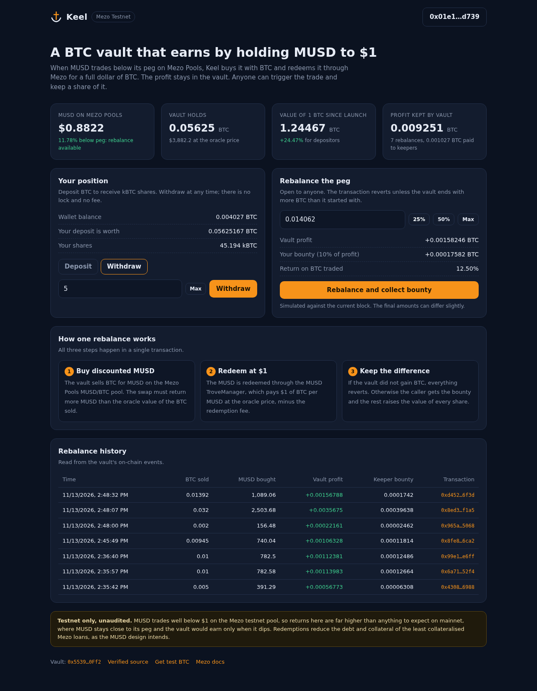

# Keel

A BTC vault on Mezo that earns by pulling MUSD back to its $1 peg.

When MUSD trades below $1 on Mezo Pools, Keel buys it with BTC and redeems it through the MUSD protocol for a full dollar of BTC. The profit stays in the vault and raises the value of every share. Anyone can trigger the trade and keep 10% of the profit as a bounty.

Built for the Mezo Buildathon, Track 1 (DeFi). Testnet only and unaudited.



## Why

MUSD holds its peg through redemptions: any holder can hand 1 MUSD to the protocol and receive $1 of BTC. That only works if someone does it when MUSD is cheap. Doing it by hand takes capital, two transactions and redemption hints that go stale every block.

Keel turns that job into a product:

- **Depositors** supply BTC and earn BTC whenever the peg slips. They stay in BTC between trades and hold MUSD only inside a single transaction.
- **Keepers** need no capital. They call one function and are paid from the profit.
- **MUSD** gets standing buy pressure below $1, funded by a pool rather than by whoever happens to be watching.

## How a rebalance works

`KeelVault.rebalance(btcIn, minProfit, deadline)` does three things in one transaction:

1. **Buy.** Sell `btcIn` BTC for MUSD on the Mezo Pools MUSD/BTC pool. The swap must return more MUSD than the oracle value of the BTC sold, otherwise MUSD is not below its peg and the call reverts.
2. **Redeem.** Redeem the MUSD through `TroveManager.redeemCollateral`. Redemption hints are computed on chain in the same transaction (see [Lessons](#lessons-from-building-on-mezo)).
3. **Check.** Revert unless the vault holds more BTC than it started with. Pay the caller 10% of the profit; the rest stays in the vault.

The vault has no owner, no admin functions and no upgrade path. Every parameter is immutable.

## Mezo integration

| Mezo contract | Call | Used for |
| --- | --- | --- |
| Mezo Pools Router | `swapExactTokensForTokens` | Buying MUSD with BTC on the MUSD/BTC pool |
| BTC token (native precompile) | `approve` | Letting the router pull the vault's native BTC |
| MUSD | `balanceOf` | Amount to redeem |
| PriceFeed | `fetchPrice` | BTC/USD price for the below-peg check and the hints |
| HintHelpers | `getRedemptionHints` | Where the redemption starts and how much can be filled |
| SortedTroves | `findInsertPosition` | Where the partly redeemed loan is reinserted |
| TroveManager | `redeemCollateral` | Redeeming MUSD for BTC at $1 |

## Deployment (Mezo testnet, chain 31611)

| | |
| --- | --- |
| KeelVault | [`0x5539E3c4Eabb7673f0a48E83B93A4a0936A30Ff2`](https://explorer.test.mezo.org/address/0x5539E3c4Eabb7673f0a48E83B93A4a0936A30Ff2?tab=contract) (source verified) |
| Deploy transaction | [`0x080d9184…7404`](https://explorer.test.mezo.org/tx/0x080d9184607db3b67b42ba31511e7110a982d47dd660134b307216bc39207404) |
| First deposit | [`0xb71d411c…8389`](https://explorer.test.mezo.org/tx/0xb71d411cbaa94bafbd38e211a5a5c59e16e6a06e7ba1d73c0f2fac0f89fe8389) |
| First rebalance | [`0x43087ed3…6988`](https://explorer.test.mezo.org/tx/0x43087ed3663cb1379b4f1d4698433c9d45b61c37fdeb79089f4adf71f4a26988) |
| Withdrawal | [`0x7229ed3f…2224`](https://explorer.test.mezo.org/tx/0x7229ed3f0a5f7ffb73c678e2c4333e3921bf2ba9d48ebffd4817ec394e482224) |

All of these transactions were sent by the project's own test wallet. They show that the mechanism works on testnet. They are not user activity.

## About the testnet numbers

MUSD trades around $0.88 on the Mezo testnet pool, so each rebalance there returns roughly 12% on the BTC traded. That is a property of the testnet pool, not a yield to expect. On mainnet MUSD stays close to $1, and the vault would earn only when the discount is larger than the redemption fee plus the swap fee. Between those moments it earns nothing.

## Lessons from building on Mezo

- **Hints must be computed on chain.** The oracle price changes every block. Redemption hints computed off chain were stale by the time the transaction landed, and every attempt reverted with "Unable to redeem any amount". Keel calls `HintHelpers` and `SortedTroves` inside `rebalance`, at the same price the TroveManager uses.
- **Small trades can be refused.** Mezo will not leave a loan below its minimum debt (1,800 MUSD plus the 200 MUSD gas deposit). If the loan at the front of the redemption queue is small, a redemption that only partly repays it is refused. A larger trade that repays it in full goes through. The app and the keeper script detect this and move to a size that works, which means the vault needs roughly 0.03 BTC or more to act in every queue state.
- **Gas varies widely.** A rebalance used between 0.65M and 7.4M gas depending on how far the redeemed loan moved in the sorted list, against a 10M block limit. The app and script send twice the estimate, capped at 9.5M.
- **Fork tests are not possible.** BTC and the price oracle are native precompiles that a local EVM does not have. `scripts/simulate.js` instead injects the vault's bytecode into a live testnet `eth_call` with a state override, so the real Mezo contracts run against real state without sending anything.

## Run it

```bash
npm install
npm test             # 14 unit tests against mocks
npm run simulate     # dry run against live Mezo testnet state, no key needed
```

To deploy and operate your own copy, put a funded testnet key in `.env` as `DEPLOYER_KEY=0x…`, then:

```bash
npm run deploy
AMOUNT=0.03 npx hardhat run scripts/deposit.js --network mezotestnet
BTC_IN=0.01 npx hardhat run scripts/rebalance.js --network mezotestnet
```

The web app is a single static page in `docs/` with no build step. Serve that folder with any static server, or publish it with GitHub Pages.

## Tests

`test/KeelVault.test.js` covers deposits and withdrawals, share pricing, the first-depositor donation attack, profit and bounty accounting, every revert path of `rebalance`, leftover MUSD from a partial fill, and re-entry through the bounty payment.

The mocks cannot represent a rebalance that loses BTC, only one that breaks even, because a local EVM cannot pull native BTC through an ERC-20 interface. The live simulation and the testnet transactions cover the real contracts on the profitable path.

## Limits and risks

- Unaudited. Do not use with real funds.
- The vault relies on the Mezo PriceFeed. A wrong oracle price could make a losing trade look profitable in dollar terms, but not in BTC terms: the final check compares BTC balances only.
- MUSD that could not be redeemed in a rebalance stays in the vault uncounted until the next rebalance redeems it.
- Redemptions repay the debt of the least collateralised Mezo loans and take the matching BTC collateral, as the MUSD design intends.
- The other direction (MUSD above $1) is not handled.

## Roadmap

1. Above-peg leg: mint MUSD against vault BTC and sell it when MUSD trades above $1, so the vault earns on both sides of the peg.
2. Keeper bot with alerts, and gas-efficient hints (`getApproxHint`) to bring the worst-case gas down.
3. Audit, then a capped mainnet launch; ERC-4626 wrapper so kBTC can be used as collateral elsewhere.

## License

MIT
